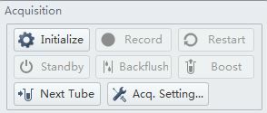

# Flow Cytometry Measurement

RP06 | ver 1.1 | Revised 2026-10-14

SUSTech-BIO 2026 iGEM Team

## Purpose

Measure BFP, EGFP and mCherry fluorescence in HEK293T (293T) cells collected from 12-well plates using a Beckman Coulter CytoFLEX S and CytExpert. This guide covers sample preparation, detector setup, basic gating, acquisition and preservation of the original event data; detailed Reporter calculations are addressed separately in RP07.

## Materials & Equipment

| Item | Supplier / model | Use / specification |
| --- | --- | --- |
| 293T samples; WT 293T control | Laboratory cultures; 12-well plates | WT cells without fluorescent constructs are the routine background control; prepare them by the same route as the samples. |
| CytoFLEX S flow cytometer | Beckman Coulter; shared facility | Tube acquisition with the installed violet, blue and yellow-green detection paths verified for BFP, EGFP and mCherry. |
| CytExpert | Beckman Coulter; version 2.3 in supplied screenshots | Experiment setup, acquisition, plots, gates and data saving. Interface details can vary with installed version. |
| Routine cell-harvest materials | See C01 Cell Passaging | Gibco Ca2+/Mg2+-free PBS, 0.25% Trypsin-EDTA, matching complete medium, collection tubes and centrifuge for the regular harvest route. |
| Cell resuspension medium / buffer | Facility-compatible laboratory formulation | Use a formulation compatible with the cells and sample inlet, consistently across compared samples; C01 ends with resuspension in fresh complete medium. No fixed flow-specific recipe or volume is asserted here. |
| Sample tubes; pipettes and tips | Compatible with the local tube holder | Transfer well-dispersed suspensions; check the holder-compatible tube and minimum sample volume before collection. |
| Daily QC beads, sheath and cleaning solutions | Facility-supplied, CytoFLEX-compatible reagents | Managed under the facility workflow. FlowClean and deionized water are used for the manufacturer Daily Clean sequence. [1] |

## Before You Start

### Method background and scope

During the initial Reporter cycles 1-6, we used the laboratory-owned Sony MA900. Its startup and calibration were time-consuming in our setting and were maintained by the laboratory administrator rather than performed by our team. We later moved to a shared CytoFLEX that required a reservation; its operating workflow was simpler for our team. This protocol therefore teaches only CytoFLEX operation and does not provide an MA900 startup, calibration or sorting procedure. This is our local workflow history, not a comparison of instrument performance.

### Reserve the instrument and check its status

Book sufficient time for setup controls, acquisition, saving and cleaning. Check with the facility whether the cytometer is already initialized and whether today's QC has passed. If startup/QC is assigned to staff, obtain its status before acquisition; a simpler interface does not remove the need for daily QC. Use the facility's startup sequence when the system is not ready. [1]

### Prepare a matched control and a representative bright sample

Include WT 293T cells processed alongside the samples, with matching medium, harvesting route and waiting time as closely as practicable. WT defines cellular background and helps locate the scatter cloud. Also reserve a small aliquot of a representative fluorescent sample to check that the brightest signals remain within detector range before recording the full series. A WT-only tube cannot test the upper fluorescence range. [7, 8]

Our routine workflow includes a WT 293T control and does not apply fluorescence compensation. Keep this choice explicit in the experiment record and verify that an old compensation matrix has not been inherited from a template. WT cells establish background but cannot estimate spillover between BFP, EGFP and mCherry; uncompensated channel signals should not be described as spectrally isolated fluorescence. If the scientific question requires reliable multi-color positivity or channel-ratio separation, add appropriate single-color controls in a separately validated workflow. [3, 7]

### Decide what the stopping count represents

For routine measurements of abundant reporter populations, approximately 10,000 events in the final cell/singlet gate is often a useful starting target. We generally acquired 100,000 events in our Reporter experiments; that is a project acquisition practice, not a universal minimum or a statement that every historical count used the same stopping gate. For a new acquisition, prefer the total retained singlet population, rather than a fluorescence-positive subset, as the stopping gate.

Collect more events when the population of interest is rare or when precise proportions or distribution tails are needed. As a sampling illustration, a 0.1% subgroup yields only about 10 events among 10,000 retained cells, compared with about 100 among 100,000. More events do not correct poor preparation, spillover or inconsistent gates; they also do not create additional biological replicates.

## Procedure

### A. Prepare the cell suspension

1. Use the routine passaging harvest in C01 as the regular preparation route: wash, detach with trypsin, neutralize, collect and gently resuspend the cells. Proceed to flow cytometry after resuspension, before reseeding. C01 supplies the established 293T detachment checkpoint and the general centrifugation condition; retain its full stopping and neutralization instructions. [9]

2. When handling many 293T samples, an optional local shortcut is to use the existing culture medium to pipette the loosely attached cells off the well and disperse them directly for acquisition. This avoids the regular harvest sequence, but can reduce cell viability and increase debris and aggregates. Use gentle pipetting rather than repeatedly forcing resistant clumps apart; return to the regular route if the suspension remains unsuitable. Record the chosen route and keep it consistent across compared samples.

3. Transfer a well-dispersed suspension into the holder-compatible sample tube. Confirm that the volume is sufficient for the holder, setup preview and planned acquisition; use the current facility requirement rather than copying a volume from another sampler. Keep waiting time short and similar between groups, and gently remix immediately before loading because cells settle. If visible clumps persist, follow the facility's approved filtration/preparation route and record the change. [1]

### B. Create the CytExpert experiment and initialize if needed

4. Open CytExpert and sign in using the facility account. Select New Experiment, give the experiment a meaningful date/project name and choose a directory you can later copy in full. An acquisition experiment uses the .xit format. Use New Experiment from Template only when the template's channels, gains, thresholds and compensation status are suitable for this experiment. [1, 10]

Figure 1. Supplied CytExpert 2.3 launch window. New Experiment starts an acquisition project; New Compensation is a separate workflow and is not used for this routine uncompensated acquisition. The displayed recent-file list is interface context, not Reporter sample metadata.

5. Confirm the green Connected status. If the instrument needs initialization, use the facility-approved System Startup Procedure / Initialize sequence and follow its prompts. The Initialize control changes to Run when acquisition becomes available. Check that daily QC is passed or has been confirmed by facility staff before running experimental samples. [1, 10]

Figure 2. Supplied acquisition controls before initialization. Initialize prepares the instrument; later Run previews the sample and Record saves events. These functions are distinct.

6. Create and name one tube per control or sample in the Tube panel before acquisition. Include the well identifier and replicate identity in the name. Confirm the selected tube every time you load a physical tube, so that subsequent files and statistics remain traceable to the original wells. [10]

### C. Select detection channels and make setup plots

7. Open Settings > Set Channel and enable the required scatter and fluorescence parameters. Retain FSC-A, SSC-A and FSC-H for cell/singlet gating, the area signal for each fluorescence channel, and Time when available for stability review. Verify each fluorescence channel by its excitation laser and installed filter, then label it BFP, EGFP or mCherry. A default dye/channel label alone does not identify the fluorescent protein. [1, 2]

| Readout | Typical starting optical assignment | Check on this instrument |
| --- | --- | --- |
| BFP | 405 nm excitation; approximately 450/45 nm detection | A violet channel may be named Pacific Blue / PB450. Verify compatibility with the BFP variant. |
| EGFP | 488 nm excitation; approximately 525/40 nm detection | Often a FITC channel; confirm the saved channel-to-protein label. |
| mCherry | 561 nm excitation; approximately 610/20 nm detection | Often Y610 on a 561 nm path. ECD may denote a different excitation path despite a similar emission window. |

These are optical examples, not a verified inventory of the shared instrument. Filters are repositionable and installed configurations vary. Confirm the actual active laser/filter map with the facility rather than selecting a similarly named channel by habit. [2]

8. Use the plot tools to create FSC-A on the horizontal axis versus SSC-A on the vertical axis, then FSC-A versus FSC-H, and one fluorescence histogram for each readout. Initially assign the scatter plot to All Events; assign later plots to their intended parent populations after drawing gates. Inspect Time versus FSC-A or event-rate stability when available. [1, 10]

### D. Adjust detector gain before recording the comparison series

Terminology: on many PMT instruments this is taught as setting detector voltage. CytoFLEX fluorescence detection uses avalanche photodiodes (APDs), and CytExpert exposes Gain. Gain changes the detector response; it is not a laser-power setting and a CytExpert gain value is not a voltage in volts. Do not transfer an MA900/PMT voltage number into this system. [2, 3]

9. Load gently mixed WT 293T cells and select Run to preview. Open Acq. Setting > Gain. Start with the facility's suitable saved settings or Recommended as an initial reference, then inspect the actual distributions. Recommended is a starting point rather than an experimentally established optimum for every reporter sample. [1, 7, 10]

10. Adjust FSC and SSC separately so that the main cell cloud is distinguishable from the near-origin debris/noise and remains fully within the scatter plot. If the cloud is compressed near the origin, cautiously raise the relevant gain; if it is pressed against the top or right measurement boundary, lower that gain. Check whether the cells really differ in preparation or morphology before attributing a changed cloud to settings. Do not use a tight gate to conceal a clipped population.

Figure 3. Original simulated scatter examples: low placement, a cloud within range, and clipping at the measurement boundary. The coordinates and rescaling are teaching examples, not observed 293T data or a numerical gain prescription. Panel B retains room around the cloud for a broad cell gate.

11. Inspect the WT background in each fluorescence channel, then preview the representative bright sample using the same tentative settings. Adjust each fluorescence gain to retain the negative distribution and the brightest relevant population within the usable range. Avoid background compressed at the measurement floor and bright events piled up at the upper detector boundary. Preserve dim populations; increasing gain cannot by itself turn overlapping biological distributions into distinct populations. [7, 8]

Figure 4. Original simulated fluorescence range examples. A uses little useful range; B preserves both background and positive signals; C clips bright events at the ceiling. WT alone would miss the failure in C. The normalized axis and event counts are illustrative, with no recommended voltage or gain values.

| Example seen during preview | Adjustment / check | What to do before recording |
| --- | --- | --- |
| Dim EGFP occupies the lowest channels together with WT | Increase the EGFP detector gain in small increments while watching both WT and the positive example; check detector/channel identity. | Retain only a setting with useful range and no high-end clipping. If overlap persists, report limited separation rather than forcing a positive gate. |
| Strong mCherry forms a pile at the maximum value | Lower only the relevant fluorescence gain and rerun the bright sample; distinguish a display limit from actual detector saturation. | Confirm the measured distribution has moved within range. Rescaling the plot cannot recover saturated values. |
| One group appears weaker after a gain change | Check whether detector settings differ, including inherited per-tube settings. | Choose common settings suitable for all groups and reacquire the affected comparison series where sample remains. |

12. Check the acquisition threshold in Acq. Setting > Threshold. Use a facility-approved scatter threshold that removes electronic noise without cutting into the cell population. Do not threshold on EGFP, mCherry or BFP merely to hide non-expressing cells: those cells may belong in the denominator. Events rejected during acquisition cannot later be restored by drawing a wider analysis gate. [1]

13. Once setup is satisfactory, save the gains, threshold and channel map, then use identical detector settings for every control and sample in the comparison. Make fluorescence plots use a common display transformation and range. Changing the display scale changes how points look; changing gain changes the acquired values. If a gain change is unavoidable, document it and reacquire the affected controls and samples with common settings rather than comparing unadjusted intensities from different settings. [3, 8]

### E. Draw a broad cell gate, then a singlet gate

14. On the WT FSC-A versus SSC-A plot, select a polygon gate and click vertices around the main cell cloud; close the polygon using the interface's completion action. Name this gate P1 cells. Keep the low-FSC near-origin debris-like cloud outside while leaving a margin around the main population. Avoid tracing only its densest core. The coordinates shown in a teaching figure are not transferable thresholds for your cells. [4, 6, 10]

15. Review P1 on representative samples using the same gain settings. Keep one justified cell-gate definition across the comparison instead of moving it independently to maximize each sample's fluorescence. If a treatment or the direct-pipetting preparation substantially changes scatter, inspect sample quality and document the issue; use a consistent review rule rather than silently excluding the altered population. FSC/SSC alone cannot certify that retained cells are viable. [4, 8]

16. Set the FSC-A versus FSC-H plot's parent to P1 cells. Draw a narrow polygon along the main correlated single-cell band and name it P2 singlets. With area on the horizontal axis and height on the vertical axis, many doublets have relatively high area for their height and lie below/to the right of this band. Follow the observed band rather than assuming a universal 45-degree line; axis ranges and pulse scaling affect its angle. Keep enough width to retain the ordinary single-cell spread. [5]

Figure 5. Original simulated gate construction. A: a broad P1 around the main scatter cloud excludes debris-like events. B: within P1, P2 follows the height/area band and excludes events with relatively high area. Neither scatter selection nor a singlet gate establishes viability. Shapes are teaching examples, not universal gates.

17. Verify the parent/child hierarchy in CytExpert: All Events > P1 cells > P2 singlets, with fluorescence histograms displaying P2. If a time review identifies an unstable segment and a time gate is justified, use All Events > stable time > P1 > P2 and report the exclusion. A sudden rate drop or spike warrants checking mixing, bubbles or the sample line; an unexplained shift should be investigated before recording a full series. [1, 6]

Figure 6. Supplied CytExpert gating screenshot. Left: FSC-A/SSC-A from All Events with P1. Middle: FSC-A/FSC-H with parent P1 and child P2. Right: an ECD-A histogram with parent P2. The displayed 45.30% and 86.25% have different parent denominators; neither is a viability measurement. The screenshot's sample identity is unconfirmed and its gates are not a validated 293T template.

18. Display WT and reporter fluorescence histograms from the same P2 parent using the same acquisition and display settings. Use the WT distribution to define a documented background/positivity boundary for each channel, then apply that boundary consistently within the comparison. Where a reporter signal overlaps WT, retain the overlap in the interpretation instead of calling a separate positive population by eye alone. [4, 7]

Figure 7. Original simulated WT/reporter overlay in a common singlet population. A WT-derived boundary is shown only to demonstrate the concept; the selected tail in this illustration is not an assay-validated or universal cutoff. With no compensation, a channel shift can also include spillover. RP07 addresses quantitative Reporter interpretation.

Gating tutorials from different sources: Bio-Rad explains scatter gates, histograms and quadrants [4]; Addgene introduces scatter and pulse geometry, including singlet discrimination [5]; FlowJo's official guide demonstrates polygon, rectangle and histogram gates [6]. Use their conceptual lessons, not their blood-cell gates or software-specific buttons, as 293T/CytExpert settings. Direct clickable links appear in Reference.

### F. Set stopping criteria and record each tube

19. Select Medium in Sample Flow Rate; on the standard CytoFLEX preset this is 30 µL/min, but confirm the live displayed rate. If cells are too concentrated, clumped or the rate is unstable, dilute in the same compatible suspension medium or use a slower rate after reviewing preparation. Do not use speed alone to force an unsuitable suspension through the inlet. [12]

20. Enable Events to Record and enter the target count. In the adjacent in population selector, prefer P2 singlets, or the corresponding final cell/singlet population, rather than All Events or a reporter-positive gate. Approximately 10,000 retained singlets is a routine starting target for abundant populations; use more when the analysis requires it. Our Reporter series commonly collected 100,000 events. Events to Display controls the preview and is not the saved-event target.

Figure 8. Supplied acquisition-panel example. Events to Record, the in population selector, Time to Record and Sample Flow Rate are separate settings. This screenshot shows 10,000 in All Events and Slow at 10 µL/min; for the present workflow choose Medium and a suitable cell/singlet stopping population instead. Its displayed values are not copied as team settings.

21. Check any enabled Time to Record or Volume to Record limit before starting: an additional stop limit can end acquisition before the target gate count is reached. Set an appropriate maximum for sample volume and booking time, then confirm the achieved P2 count afterward. A tube that stops early must be identified by its actual retained count rather than labelled as meeting the planned target.

22. Remix gently, load the correct physical tube and use Run to inspect stability and positioning. Confirm the selected tube name and the saved settings, then select Record to save the acquisition. Monitor event rate, abort information and scatter distributions. If blockage, bubbles or severe instability appears, stop, address preparation/fluidics with the facility and repeat a stable acquisition when possible. Wait for saving to finish before removing the tube. [1, 10]

23. Proceed through the remaining tubes with the same settings and a consistent mixing/loading sequence. Use the facility's between-sample rinse or backflush procedure, particularly after a bright or aggregate-rich sample. Retain a WT check later in a long series where practical to detect background/carryover changes. Do not alter gates or gains tube by tube merely to make percentages look similar.

### G. Save original data and complete the instrument handoff

24. Save the experiment and verify that every recorded tube has an FCS event file. Copy both the .xit file and its associated same-name data folder together; the experiment file alone is not the event data. Preserve the complete recorded event data, scatter and fluorescence channels, Time when acquired, gains/threshold information and explicit uncompensated status. Selecting P2 as the stopping population is not a reason to discard all other recorded events from the archival copy. [11]

25. Create a Statistics table for cell/singlet counts, gate percentages and the required fluorescence summary, and explicitly identify each statistic's parent population. For a CSV summary, right-click the statistics table and use Export All Samples to CSV File after applying the intended settings to all tubes. Save the gate hierarchy/worksheet as well. CSV summaries and screenshots complement the FCS files rather than replacing them. [1]

26. Reopen the saved copy and confirm that a WT control and at least one sample display their event data correctly, that the tube names match the well records, and that the intended settings and gate hierarchy remain available. Retain a short sample sheet containing well/replicate identity, harvesting route, actual stopping population/count, gain/threshold settings, compensation status and any interrupted acquisition.

27. Complete the cleaning and handoff required by the shared facility. For the manufacturer Daily Clean procedure, select Cytometer > Daily Clean and follow the wizard using 2 mL FlowClean followed by 3 mL deionized water; the quick guide lists default stages of 3 min and 5 min. Do not substitute bleach in this sample-line sequence. If you are the final user, perform the assigned shutdown; otherwise leave the system in the status requested for the next booking. Maintenance and unresolved QC failures belong with facility staff. [1]

## p.s.

293T cells can be lifted by pipetting in old medium, but this convenience can produce more damaged cells, fragments and aggregates. Keep the preparation route comparable between groups and inspect the suspension before loading; a cleaner gate cannot fully repair a compromised sample.

Use WT for background and a bright sample for upper-range setup. Finalize gains before recording the comparison, and check that copied tubes/templates did not retain different settings or an unrelated compensation matrix.

Read every gate percentage together with its parent. P1 as a fraction of All Events, P2 as a fraction of P1, and reporter-positive events as a fraction of P2 are different quantities. Name the denominator explicitly in exported tables and figures.

The routine WT-only, uncompensated workflow provides channel-level fluorescence observations. It does not demonstrate absence of spillover, and scatter-selected singlets must not be relabelled live cells without a suitable viability measurement.

Reserve time to copy and reopen the full experiment before leaving the instrument. Keep the .xit and its data folder together, and retain FCS files for later re-gating; a screenshot or CSV cannot recover discarded events.

## Expected Outcome

Obtain traceable FCS files for WT and each 293T sample, with an interpretable main scatter population, a documented singlet gate, measured fluorescence within range and sufficient events for the intended comparison. Record the actual retained count and any setup or sample-quality deviations.

Fluorescence is a reporter readout, not direct evidence of RNA editing. This uncompensated workflow does not independently establish spectral separation or viability, and measurements from Sony MA900 and CytoFLEX are not automatically comparable on an absolute intensity scale.

## Troubleshooting

| Observed problem | Check first | Suggested action |
| --- | --- | --- |
| Many near-origin events or a low P1 fraction | Harvest route, cell condition, waiting time and threshold/gain settings | Inspect the suspension and WT. If direct pipetting damaged the sample, use the regular harvest route for a repeat; retain a broad justified cell gate rather than forcing the expected fraction. |
| Broad off-band FSC-A/FSC-H events or frequent clumps | Dispersion, settling, concentration and inherited parent population | Remix gently, check that the singlet plot uses P1, and correct preparation/dilution. Use approved filtration if needed; record it. |
| Scatter cloud compressed near origin or pressed against the edge | Scatter gain, actual measurement range and sample quality | Adjust relevant scatter gain during setup, then reacquire with common settings. Widening a display or gate cannot repair acquisition clipping. |
| Fluorescence at the floor or piled at the ceiling | WT plus a bright sample, optical channel and actual saturation versus display limits | Optimize the channel gain before the series. Lower gain for saturated positives; check dim/background separation at higher gain. Reacquire affected samples where possible. |
| Background increases after a bright tube | Carryover, rinse status and WT stability | Run the prescribed rinse/cleaning sequence and reacquire a WT check. If the baseline remains shifted, ask facility staff to assess the sample line. |
| Event rate drops, spikes or remains unstable | Settling, bubbles, sample volume, aggregates and abort behavior | Pause acquisition; remix/check volume and preparation. Use the facility-approved backflush/cleaning route. Reacquire a stable tube rather than silently accepting unexplained segments. |
| Target count not reached despite a completed acquisition | Stopping population, time/volume limits and actual P2 count | Correct stop settings and continue/repeat if sufficient sample remains. Report the achieved count and do not equate All Events with retained cells. |
| Apparent multi-color positivity in an uncompensated sample | WT background, channel map and possible spillover from bright proteins | Report channel-level observations with the uncompensated limitation. For a claim requiring spectral separation, acquire appropriate single-color controls and validate compensation separately. |
| Saved experiment opens without event data | .xit location, same-name folder and per-tube FCS files | Restore the complete experiment/data-folder pair from the recorded acquisition. Confirm data load before relying on exported summary tables. |

## Reference

[1] Beckman Coulter. CytoFLEX Quick User Guide, hosted by OHSU; filename identifies 2021. Printed pp. 4-6, 10-12 and 14-15: startup/QC, acquisition and Daily Clean. Accessed 2026-10-13. [Open source](<https://www.ohsu.edu/sites/default/files/2023-03/CytoFLEX-startup-guide-2021.pdf>)

[2] Beckman Coulter. CytoFLEX Flow Cytometer Platform brochure. PDF pp. 3-4 and 8: APD detection, optical channel examples and gain response. Accessed 2026-10-13. [Open source](<https://pages.beckman.com/rs/682-XWP-826/images/fmna-mult-becls-talks-21-08-cytoflex-brochure-pdf.PDF>)

[3] Beckman Coulter. Gain Independent Compensation, two-page manufacturer flyer. APD gain versus PMT voltage and compensation/gain behavior. Accessed 2026-10-13. [Open source](<https://media.beckman.com/-/media/pdf-assets/flyers/flow-cytometer-cytoflex-gain-independent-compensation-flyer.pdf?rev=51db02c7f2d34cb7b1751a22b791d197>)

[4] Bio-Rad. Gating Strategies for Effective Flow Cytometry Data Analysis. Illustrated tutorial for scatter gates, histograms, quadrants and controls. Accessed 2026-10-13. [Open source](<https://www.bio-rad-antibodies.com/flow-cytometry-gating-strategies.html>)

[5] Addgene. Antibodies 101: Introduction to Gating in Flow Cytometry. FSC/SSC and pulse area/height/width for cell and singlet selection. Accessed 2026-10-13. [Open source](<https://blog.addgene.org/antibodies-101-introduction-to-gating-in-flow-cytometry>)

[6] FlowJo. Drawing Gates, official documentation. Illustrated polygon, rectangle, quadrant and histogram gate tutorials. Accessed 2026-10-13. [Open source](<https://docs.flowjo.com/flowjo/graphs-and-gating/gw-gating/gw-gatedrawing/>)

[7] Bio-Rad. Controls for Flow Cytometry. Unstained and single-color controls, detector/background setup and viability considerations. Accessed 2026-10-13. [Open source](<https://www.bio-rad-antibodies.com/flow-cytometry-controls.html>)

[8] Bio-Rad. 9 Tips to Get Publication Ready Flow Plots. Detector range, overly tight scatter gates and viability cautions. Accessed 2026-10-13. [Open source](<https://www.bio-rad-antibodies.com/blog/9-tips-to-get-publication-ready-flow-plots.html>)

[9] SUSTech-BIO 2026 iGEM Team. C01 Cell Passaging, ver 1.1, revised 2026-10-03. Maintained local protocol: Protocols/C01/C01_Cell_Passaging.md and corresponding PDF.

[10] User-provided CytExpert 2.3 screenshots: nine JPG files in Protocols/cyto teach, inspected 2026-10-13. Exact filenames and checksums: sources/screenshot_manifest.json. Local workflow and instrument history confirmed by the user on 2026-10-13.

[11] Beckman Coulter. Migration of Panels Designed on CytoFLEX S to CytoFLEX SRT. Figure 2: .xit and same-name FCS folder association. Accessed 2026-10-13. [Open source](<https://www.beckman.com/resources/reading-material/application-notes/migration-of-panels-designed-on-cytoflex-s-to-cytoflex-srt>)

[12] Beckman Coulter Japan. CytoFLEX S / LX platform specifications: sample-flow presets, including Medium 30 µL/min. Accessed 2026-10-13. [Open source](<https://www.beckman.jp/en/landing/japan/2024/cytoflex-s-and-lx-campaign>)
